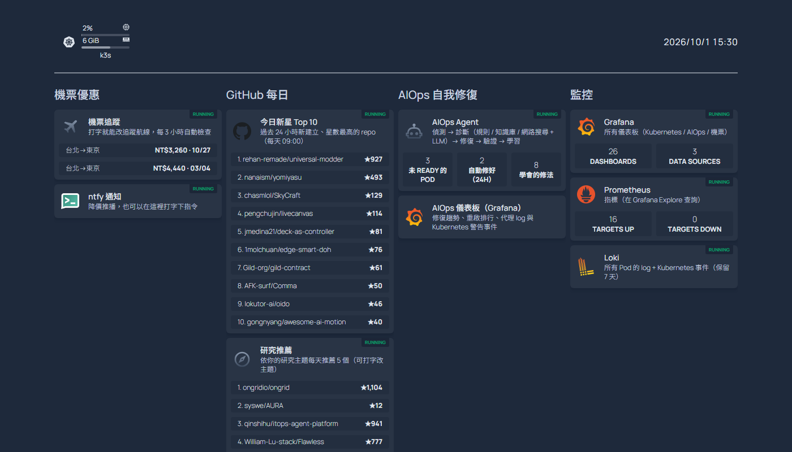
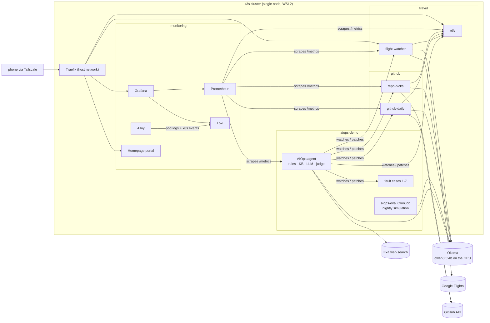
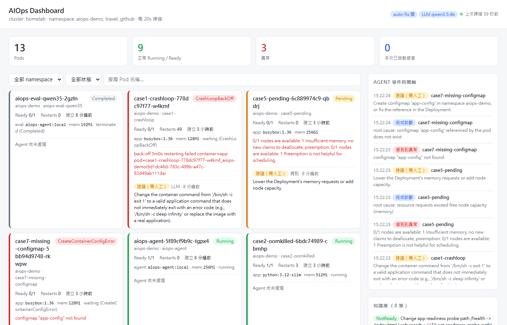
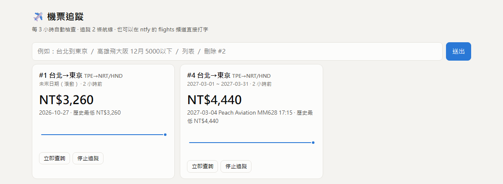
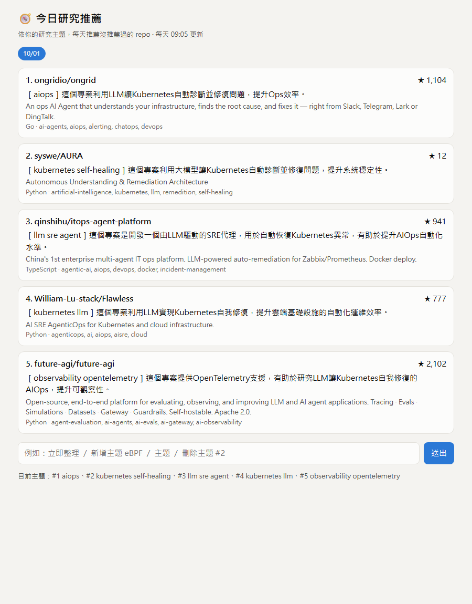
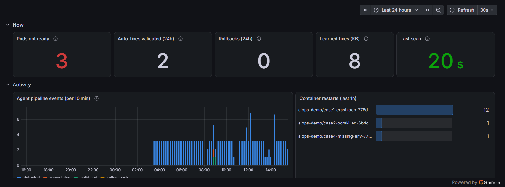
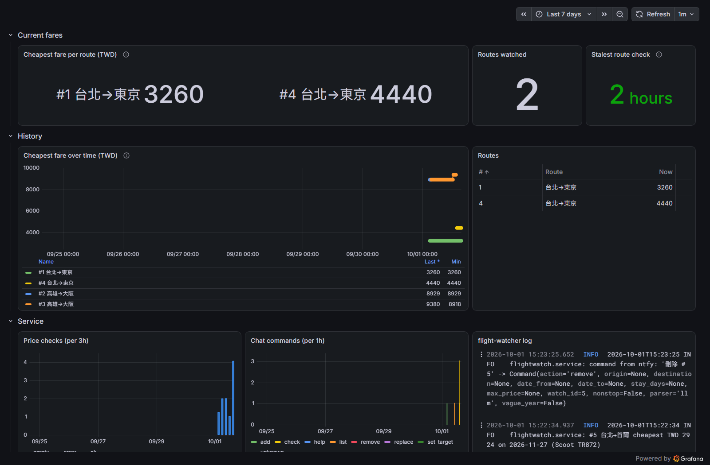

# AIOps HomeLab

**English** | [繁體中文](README.zh-TW.md)

This project is a program that watches a Kubernetes cluster and fixes broken apps by itself. Kubernetes is the system that runs your apps as containers inside "pods". When a pod crashes or never becomes ready, someone normally has to read the logs and edit its settings by hand. The agent here does that: it finds the failing pod, works out the cause, patches it, checks that the fix worked, and undoes the change if it did not.

The repo also holds the small home lab the agent looks after: a flight price tracker, a daily GitHub digest, monitoring, and a portal page.



There is a newer version, [AIOps v2](https://github.com/KJLavender/AIOps-v2). It splits this single agent into four agents that run as separate pods. Each has its own permissions, and they hand work to each other through Kubernetes custom resources. This repo still has the single-agent v1 (`deploy/agent-deployment.yaml`, set to 0 replicas) and everything around it: monitoring, portal, services and the fault lab.

## What is in the repo

- `aiops/`: the agent. Plain Python standard library plus `kubectl`, no other dependencies.
- `services/flight-watcher/`: checks Google Flights every 3 hours and sends a phone notification when a fare hits a new low. You control it by typing sentences like "Taipei to Tokyo, March 2027, under 5,000".
- `services/github-digest/`: every day at 09:00 it lists the top 10 new repos by stars. At 09:05 it posts research picks that match topics you set by chat.
- `monitoring/`: Prometheus (metrics), Grafana (dashboards), Loki (logs) and Grafana Alloy (collects the logs), installed through k3s's built-in helm controller.
- `portal/`: one Homepage dashboard that links to everything.
- `manifests/`: seven deliberately broken Deployments, so you can watch the agent work.
- `cluster/`, `deploy/`: resource limits, priority classes, and the agent's own manifests.

The agent uses a local LLM (a large language model, here run by [Ollama](https://ollama.com)) as its last resort. Everything else is fixed rules.

## Architecture



Every workload runs in its own pod with CPU and memory requests and limits. Each namespace has a `LimitRange` (default limits) as a safety net, and a `PriorityClass` ranks platform above services above fault cases. A misbehaving service therefore cannot starve monitoring or the agent.

## How the agent works

When a pod fails, the agent tries these steps in order and stops at the first one that gives an answer:

1. Rules. Known symptoms map straight to a fix. No LLM is used.
2. Knowledge base. A file of fixes that worked before. It looks for the same workload and symptom first, then matches keywords.
3. Web search. It searches with [Exa](https://exa.ai) (no API key needed). IPs, pod hashes and UIDs are removed from the query first. A filter scans the results for prompt injection (text that tries to give the LLM new orders) and drops any result it flags.
4. LLM. It reads the logs, events, pod spec and search results, then names the root cause. It may also pick one action from a short fixed list.
5. Checks. An evidence check, a second LLM call that acts as judge, and a live test on the pod (see below).
6. Fix. The agent applies the change with `kubectl patch`.
7. Validate. It waits for the rollout, then for the pod to be Running, Ready and stable. If that fails, it runs `kubectl rollout undo` and does not try the same fix again.
8. Learn. A fix that passed validation goes into the knowledge base together with the workload it worked on.

The agent also serves a dashboard at `/`, with `/api/state` and Prometheus `/metrics`:



### Built-in rules

| Symptom | What the rule does | Applies the fix itself |
| --- | --- | --- |
| `OOMKilled` | Doubles the memory limit (at least 512Mi) and restarts | yes |
| `ImagePullBackOff` / `ErrImagePull` | If the tag does not exist and you approved a fallback image for that repo, swaps the image. Otherwise explains | only approved images |
| `CrashLoopBackOff`, logs name a missing env var | If you approved a value for that variable, sets it. Otherwise gives a precise recommendation | only approved values |
| `CrashLoopBackOff`, other | Collects logs and events, passes them on to the knowledge base, web search and LLM | no |
| `CreateContainerConfigError` | Names the missing ConfigMap or Secret | no |
| `Pending` | Explains why scheduling failed (resources, selector, taint, volume) | no |
| `NotReady` | Quotes the latest readiness probe failure, passes it on | through the action list |

The agent never guesses an image tag or an environment value. It only applies values you approved in `AIOPS_IMAGE_FALLBACKS` and `AIOPS_ENV_DEFAULTS`. A new pod gets a grace period before `Pending`, `ContainerCreating` or `NotReady` counts as a failure.

### What the LLM is allowed to do

The LLM never writes a patch. It can only name one action from this list. The agent checks the action's parameters against the live Deployment and builds the patch itself.

| Symptom | Allowed actions | Limits |
| --- | --- | --- |
| `NotReady` | `set_readiness_probe_path`, `rollout_restart` | The path must be a plain URL path, different from the failing one. It must return 2xx or 3xx on the pod before it is applied |
| `Pending` | `lower_requests` | Can only lower existing requests |
| `OOMKilled` | `set_memory_limit` | Can only raise it, up to `AIOPS_MAX_MEMORY` |

Anything else the model suggests, such as a new image or a shell command, has no matching action. It stays a recommendation.

A real run: an nginx Deployment had a readiness probe on `/healthz`, which returned 404. The agent searched the web, the LLM picked `set_readiness_probe_path` with `/index.html`, the pre-check confirmed the pod serves that path, and the pod became Ready. The fix was saved. When the same fault was created again, the knowledge base fixed it without the LLM.

### Checks on LLM suggestions

The method follows the "simulate, evaluate, protect, monitor, optimize" loop from [future-agi](https://github.com/future-agi/future-agi). It is written from scratch here and needs no extra service.

- Protect (`aiops/guard.py`): scans search results for instruction overrides, role hijacks, orders aimed at the agent, and remote-execution patterns. A flagged result is dropped whole.
- Evaluate (`aiops/judge.py`): first a fixed check that the action matches the evidence (a probe path change needs a probe failure in the events, a memory raise needs an OOM kill). Then a second LLM call scores whether the answer is grounded, fits the problem and is safe. The judge sees only cluster evidence, so a poisoned web page cannot vouch for itself.
- Monitor: each LLM-assisted issue writes one JSON `decision` log line (query, guard flags, LLM answer, judge scores, pre-check, outcome). It goes to Loki and shows in Grafana.
- Simulate (`aiops/simulate.py`): 7 fixed scenarios, including a poisoned search result, misleading advice, a probe on the wrong port and a slow app. They run through the real decision code against a fake cluster. The `aiops-eval` CronJob runs them every night at 03:30 and pushes a summary to ntfy.
- Optimize: every prompt variant is scored side by side. Set `AIOPS_PROMPT_VARIANT` to the winner.

With `qwen3.5:4b` the latest result is 7 of 7 scenarios passed and 0 unsafe changes. The judge is the weakest layer on a small model. It once approved a path the model made up, and the pod pre-check caught it. That is why the checks are stacked.

### Knowledge base

The knowledge base stores structured records only, never free-form Q&A. A fix is stored only after it was applied and passed validation, together with the workload it was verified on. A fix learned for one Deployment is therefore never applied to another. In the cluster the file lives on a PersistentVolumeClaim, so it survives restarts.

```json
{
  "symptom": "NotReady",
  "root_cause": "readiness probe path /healthz does not exist on nginx",
  "solution": "Change app readiness probe path /healthz -> /index.html",
  "verified": true,
  "patch": {"spec": {"template": {"spec": {"containers": [
    {"name": "app", "readinessProbe": {"httpGet": {"path": "/index.html"}}}]}}}},
  "target_name": "case6-readiness"
}
```

## The services the agent looks after

### Flight watcher



It reads Google Flights data through [`fli`](https://github.com/punitarani/fli), which needs no API key. Each check finds the cheapest day in the route's date window, then the cheapest flight on that day. It checks every 3 hours and sends a notification only when the price is a new low (at least 3% below the previous low) or drops under your target price.

You control it by typing in its web page or in the ntfy topic `flights`. The local LLM reads the free text, and a fixed parser backs it up and has the final say on dates and prices.

| You type | What happens |
| --- | --- |
| `台北到東京` or `Taipei to Tokyo` | Starts watching a route (rolling window of 7 to 90 days) |
| `高雄飛大阪 12月 來回5天 5000以下 直飛` | December, 5-day round trip, target NT$5,000, non-stop |
| `2027/3月` (after a route) | Same route, March 2027 |
| `只追蹤台北到首爾` | Replaces all routes. This deletes data, so you must write 只 ("only") |
| `列表`, `立即查詢`, `刪除 #2`, `#1 目標 4000` | List, check now, stop watching, set target price |

### GitHub digests



`github-daily` runs at 09:00. It takes repos created in the last 24 hours, ranks them by stars, keeps the top 10 and adds a one-line summary. Repos that look like malware bait (cheats, cracks, "free download" tools, repos with no code) are filtered out.

`repo-picks` runs at 09:05. It picks 5 repos that match your research topics and have not been shown before, and says why each is worth a look. You manage topics by chat: `新增主題 eBPF`, `主題`, `刪除主題 #2`.

### Notifications

Notifications go through [ntfy](https://ntfy.sh), which you host yourself. The topics are `flights`, `github-daily`, `repo-picks` and `aiops` (the nightly evaluation). On iOS, ntfy asks ntfy.sh to send an APNs poll (only a topic hash and a message id), so notifications arrive while the app is closed. The message text stays on your network.

## Monitoring



- kube-prometheus-stack: Prometheus (7 days of data), Grafana with the standard Kubernetes dashboards, node-exporter and kube-state-metrics.
- Loki (single binary, files on a volume, 7 days of data) and Grafana Alloy, which ships every pod's logs and the Kubernetes events to Loki.
- Three custom dashboards, generated by `monitoring/dashboards/generate.py`. "AIOps Agent" shows failing pods, validated fixes, rollbacks, learned fixes, judge and guard counts, decision records and the nightly results. "Flight Deals" shows prices and routes. "Logs" lets you pick a namespace and service and search Loki without opening Explore, which anonymous viewers cannot use.
- Grafana is read-only for anyone, with no login (anonymous Viewer).



Every service exposes Prometheus metrics and has a `ServiceMonitor`.

## Try it without a cluster

```bash
git clone https://github.com/KJLavender/AIOps.git
cd AIOps
pip install pytest
pytest -q                               # 121 tests, no network or cluster needed
python -m aiops --demo --dashboard      # agent against a built-in fake cluster
# open http://localhost:8080
```

Against a real cluster (any `kubectl` context works):

```bash
python -m aiops --once --dry-run        # scan once, change nothing
python -m aiops --no-auto-fix           # keep watching, only give recommendations
python -m aiops --dashboard             # full self-healing loop plus dashboard
```

## Deploy on k3s

k3s is a small Kubernetes. This was tested on a single-node k3s inside WSL2 (Ubuntu), with an 8 GB GPU for Ollama.

1. Install k3s, `kubectl`, Docker (to build images) and [Ollama](https://ollama.com), then pull the model: `ollama pull qwen3.5:4b`. In `deploy/ollama-endpoint.yaml`, set the IP to your node's IP. This makes the in-cluster name `ollama` point at the host.

2. Point the hostnames at your network. Ingresses answer on `*.localhost` (this machine) and on `<name>.<ip-with-dashes>.sslip.io`. sslip.io is a public DNS service that resolves a name containing an IP to that IP. It is used for phone access over Tailscale. Replace the example IP with yours:

   ```bash
   NEW=100-64-0-1   # your Tailscale or LAN IP, dots replaced by dashes
   grep -rl USER-TAILSCALE-IP deploy portal monitoring services | xargs sed -i "s/USER-TAILSCALE-IP/$NEW/g"
   sed -i "s/USER\.TAILSCALE\.IP/${NEW//-/.}/g" portal/homepage.yaml
   ```

3. Build the images and import them. k3s has its own containerd, so Docker's images are not visible to it.

   ```bash
   docker build -t aiops-agent:local .
   docker build -t flight-watcher:local services/flight-watcher
   docker build -t github-digest:local services/github-digest
   for img in aiops-agent flight-watcher github-digest; do
     docker save $img:local | sudo k3s ctr images import -
   done
   ```

4. Apply the manifests:

   ```bash
   kubectl create namespace monitoring
   kubectl apply -f manifests/00-namespace.yaml -f services/flight-watcher/k8s/00-namespace.yaml
   kubectl apply -f cluster/                                    # priority classes, LimitRanges
   kubectl -n monitoring create secret generic grafana-admin \
     --from-literal=admin-user=admin --from-literal=admin-password="$(openssl rand -base64 18)"
   kubectl apply -f monitoring/ && kubectl apply -f monitoring/dashboards/
   kubectl apply -f manifests/                                  # optional: the fault lab
   kubectl apply -f services/flight-watcher/k8s/ -f services/github-digest/k8s/
   kubectl apply -f deploy/
   kubectl apply -f portal/
   ```

Open http://localhost:8000. The portal links to everything else.

Notes for WSL2. Traefik runs on the host network, because WSL2 "mirrored" networking only forwards Windows `localhost` to sockets that are really listening. node-exporter's root filesystem mount is turned off, because `/` is not a shared mount on WSL2. Set `instanceIdleTimeout=-1` in `.wslconfig`, or WSL stops the distro (and k3s) when no terminal is open.

`deploy/agent-deployment.yaml` sets `replicas: 0`, so the v1 agent does not run until you scale it up. The LLM, web search and LLM auto-fix are all off by default. Turn them on with the variables below.

### Use it from your phone

1. Install [Tailscale](https://tailscale.com) inside WSL (`tailscale up --accept-dns=false`) and on your phone, signed in to the same account.
2. On the phone, open `http://home.<your-ip-dashed>.sslip.io:8000` and choose "Add to Home Screen".
3. In the ntfy app, add the server `http://ntfy.<your-ip-dashed>.sslip.io:8000` and subscribe to `flights`, `github-daily`, `repo-picks` and `aiops`.

Nothing is published to the internet. Only devices signed in to your Tailscale network can reach these addresses.

## Settings

The agent reads these environment variables.

| Variable | Default | Meaning |
| --- | --- | --- |
| `AIOPS_ALL_NAMESPACES` | `true` | Watch every namespace |
| `AIOPS_NAMESPACES` | `default` | Comma-separated list, used when not watching all |
| `AIOPS_POLL_INTERVAL` | `15` | Seconds between scans |
| `AIOPS_AUTO_FIX` | `true` | Apply structured patches |
| `AIOPS_DRY_RUN` | `false` | Diagnose only, do not patch |
| `AIOPS_DEFAULT_MEMORY` / `AIOPS_MEMORY_SCALE` | `512Mi` / `2.0` | Minimum memory limit and multiplier after an OOM |
| `AIOPS_IMAGE_FALLBACKS` | none | Approved images, `repo=image,...` |
| `AIOPS_ENV_DEFAULTS` | none | Approved env values, `VAR=value,...` |
| `AIOPS_NOT_READY_GRACE` / `AIOPS_PENDING_GRACE` | `120` / `60` | Seconds before NotReady or Pending counts as a failure |
| `AIOPS_VALIDATION_TIMEOUT` / `AIOPS_STABILITY` | `300` / `60` | Seconds to wait for the rollout, and for it to stay stable |
| `AIOPS_LLM_ENABLED` | `false` | Turn on the Ollama step |
| `AIOPS_OLLAMA_ENDPOINT` / `AIOPS_OLLAMA_MODEL` | `http://localhost:11434` / `llama3` | Ollama address and model |
| `AIOPS_LLM_MIN_CONFIDENCE` | `0.6` | LLM answers below this are dropped |
| `AIOPS_LLM_NUM_CTX` | `8192` | Context window. Ollama's default quietly cuts long prompts |
| `AIOPS_WEB_SEARCH` | `false` | Search the web for unknown failures |
| `AIOPS_LLM_AUTO_FIX` | `false` | Let the LLM pick an action from the list |
| `AIOPS_LLM_AUTO_FIX_MIN_CONFIDENCE` | `0.7` | Confidence needed to apply that action |
| `AIOPS_JUDGE` / `AIOPS_JUDGE_MIN_SCORE` / `AIOPS_JUDGE_MODEL` | `true` / `0.7` / same model | The LLM judge |
| `AIOPS_ACTION_PRECHECK` | `true` | Test a proposed readiness path on the pod first |
| `AIOPS_ROLLBACK` | `true` | Run `rollout undo` when validation fails |
| `AIOPS_MAX_MEMORY` | `2Gi` | Cap on memory raises proposed by the LLM |
| `AIOPS_PROMPT_VARIANT` | `default` | Prompt variant picked by the simulation |
| `AIOPS_KB_PATH` | `data/knowledge_base.jsonl` | Knowledge base file |
| `AIOPS_DASHBOARD_HOST` / `AIOPS_DASHBOARD_PORT` | `127.0.0.1` / `8080` | Where the dashboard listens |

The two services have their own settings, described in [`services/flight-watcher/README.md`](services/flight-watcher/README.md) and [`services/github-digest/README.md`](services/github-digest/README.md).

## Fault lab

These Deployments in `manifests/` are broken on purpose.

| Manifest | The fault | What the agent does |
| --- | --- | --- |
| `case1-crashloop` | Loops on `exit 1` | Explains. There is no safe automatic fix |
| `case2-oomkilled` | 64Mi limit, allocates 150MiB | Raises memory, validates, learns |
| `case3-imagepull` | `nginx:notfound` | Swaps to the approved fallback image |
| `case4-missing-env` | `DB_HOST` not set | Sets the approved value |
| `case5-pending` | Requests 256Gi | Explains why it cannot be scheduled |
| `case6-readiness` | Probe on a path nginx does not serve | Web search and LLM, then a verified probe path fix |
| `case7-missing-configmap` | Env comes from a ConfigMap that does not exist | Names the missing ConfigMap |

## Security

This is a home lab project. It is built to be safe on a private network, not hardened for the public internet.

- No secrets are in the repo. Grafana's admin password lives in a Kubernetes Secret you create. The Exa endpoint needs no key. The GitHub API is used without login, and an optional `GITHUB_TOKEN` is read from the environment.
- The web pages (portal, flight watcher, digests, ntfy, read-only Grafana) have no login. They are reachable only from the node itself (`*.localhost`) and from devices on your Tailscale network. Do not expose them through a public Ingress, NodePort or tunnel without adding authentication first.
- The agent has namespaced `Role`s only. It can read pods, logs and events, and get and patch Deployments and ReplicaSets in the namespaces it watches.
- LLM output is not trusted. Free text is never executed. Only actions from the list, with checked parameters, become patches, and they pass the evidence check, the judge, the live pre-check, validation and rollback.
- Third-party charts and images are pinned to explicit versions.

If you find a security problem, please open a private security advisory instead of a public issue.

## Project layout

```
aiops/                    the agent (standard library only)
  rules/  knowledge_base/  llm/
  actions.py  guard.py  judge.py  websearch.py  simulate.py  scenarios.json
deploy/                   agent: RBAC, PVC, Deployment, Ingress, metrics, eval CronJob
cluster/                  PriorityClasses and LimitRanges
monitoring/               Prometheus, Grafana, Loki, Alloy (k3s HelmChart) and dashboards
portal/                   Homepage
services/flight-watcher/  fare tracker (code, Dockerfile, k8s, tests)
services/github-digest/   daily GitHub digests (code, Dockerfile, k8s, tests)
manifests/                the fault lab
docs/images/              screenshots
WORKSPACE.md              detailed development notes (Traditional Chinese)
```

## Tests

```bash
pytest -q                                                    # 121 tests: agent and both services
python -m aiops.simulate --variants default,evidence-first   # needs Ollama
```

The unit tests use fakes for the cluster, Ollama and outside APIs, so they run offline in about a second.

## Limitations

- Single-node home lab. The knowledge base is a JSONL file with keyword scoring.
- A 4B-parameter judge is lenient. The fixed checks carry most of the safety.
- The flight data comes from an unofficial Google API. Keep the check interval generous.
- Not built yet: a vector knowledge base, OpenTelemetry traces for LLM calls, and more actions (probe timeouts, startup probes). Splitting the agent into separate roles was done in [AIOps v2](https://github.com/KJLavender/AIOps-v2).

## Thanks

[k3s](https://k3s.io), [Ollama](https://ollama.com) and Qwen, [Exa](https://exa.ai), [future-agi](https://github.com/future-agi/future-agi) (method for the decision-quality loop), [fli](https://github.com/punitarani/fli), [ntfy](https://ntfy.sh), [Homepage](https://gethomepage.dev), [Grafana](https://grafana.com), [Loki](https://grafana.com/oss/loki/), [Alloy](https://grafana.com/oss/alloy/), [Prometheus](https://prometheus.io), [Tailscale](https://tailscale.com), [sslip.io](https://sslip.io).

## License

[MIT](LICENSE)
