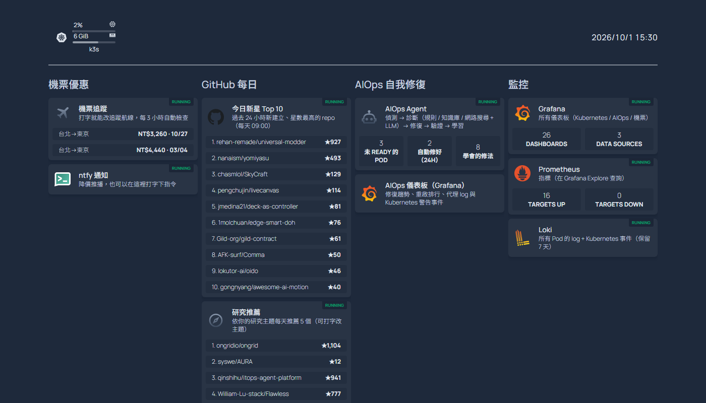
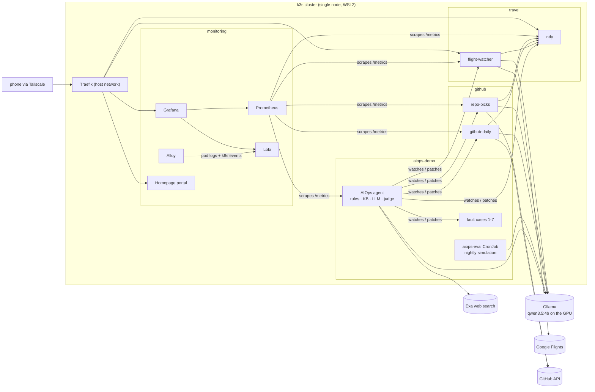
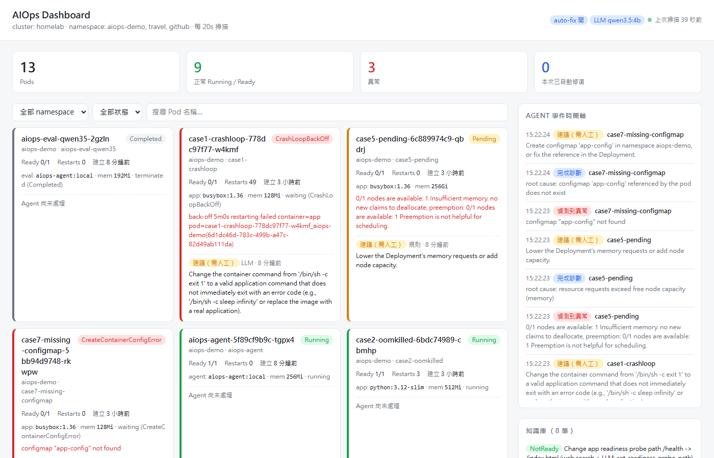
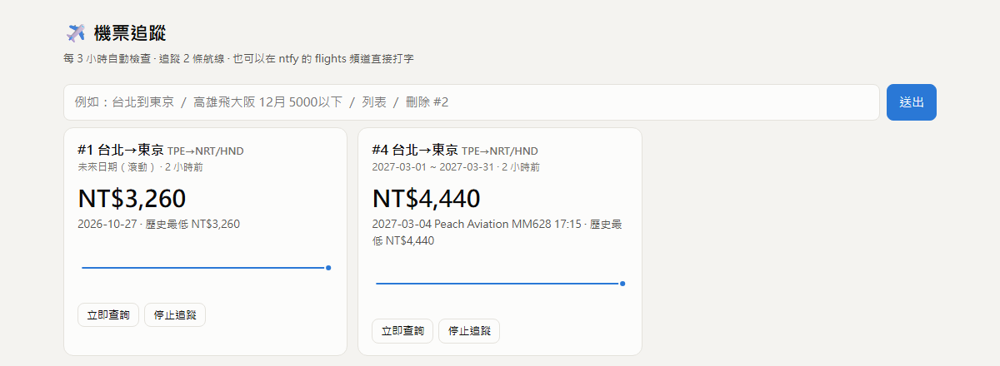
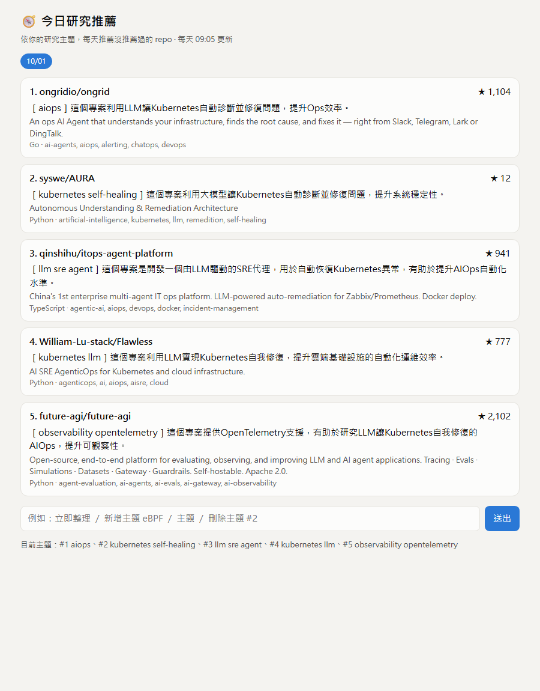
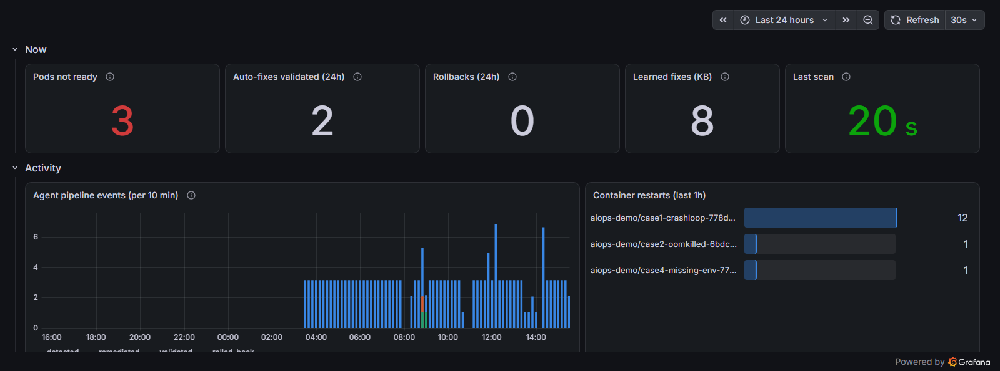
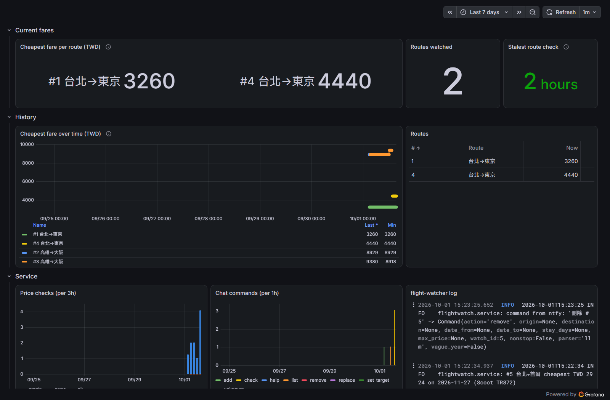

# AIOps HomeLab

[English](README.md) | **繁體中文**

這個專案是一支會自己盯著 Kubernetes 叢集、自己修壞掉的 app 的程式。Kubernetes 是用來把 app 當成容器、放在一個個「pod」裡執行的系統。pod 當掉或一直起不來的時候，通常得有人去看 log、手動改設定。這裡的 agent（自動做事的程式）幫你做這些事：找出壞掉的 pod、判斷原因、打補丁、確認修好了沒有，沒修好就復原。

這個 repo 也放了 agent 照顧的那套家用實驗環境：機票價格追蹤、每日 GitHub 精選、監控，還有一個入口網頁。



另外有比較新的版本：[AIOps v2](https://github.com/KJLavender/AIOps-v2)。它把這一支 agent 拆成四支，各自跑在獨立的 pod 裡，權限各自分開，再透過 Kubernetes custom resource（自訂資源）互相交接工作。這個 repo 仍保留單一 agent 的 v1（`deploy/agent-deployment.yaml`，replicas 設為 0），以及它周邊的東西：監控、入口網頁、各項服務和故障實驗室。

## repo 裡有什麼

- `aiops/`：agent 本體。只用 Python 標準函式庫加上 `kubectl`，沒有其他套件。
- `services/flight-watcher/`：每 3 小時查一次 Google Flights，票價創新低就推播到手機。你用一般句子操作，例如「台北到東京，2027 年 3 月，5000 以下」。
- `services/github-digest/`：每天 09:00 列出新 repo 的星數前 10 名；09:05 依照你用聊天設定的主題，推播研究精選。
- `monitoring/`：Prometheus（收指標）、Grafana（儀表板）、Loki（存 log）和 Grafana Alloy（收集 log），由 k3s 內建的 helm controller 安裝。
- `portal/`：一個 Homepage 入口網頁，連到所有東西。
- `manifests/`：七個故意弄壞的 Deployment，讓你看 agent 怎麼處理。
- `cluster/`、`deploy/`：資源限制、優先順序，以及 agent 自己的部署檔。

agent 最後才會用到本機的 LLM（大型語言模型，這裡由 [Ollama](https://ollama.com) 執行），其他步驟都是固定的規則。

## 架構



每個工作都跑在自己的 pod 裡，並設定 CPU 和記憶體的 requests（保證量）與 limits（上限）。每個 namespace 另有 `LimitRange`（預設上限）當安全網，再用 `PriorityClass` 排出順序：平台高於服務，服務高於故障案例。這樣出問題的服務就搶不走監控或 agent 的資源。

## agent 怎麼運作

pod 出問題時，agent 依序試下面幾個步驟，第一個有答案的就用它：

1. 規則。已知的症狀直接對應到修法，不用 LLM。
2. 知識庫。一個記錄「以前修成功過的做法」的檔案。先找同一個工作加上同樣的症狀，找不到再用關鍵字比對。
3. 網路搜尋。用 [Exa](https://exa.ai) 搜尋（不需要 API key）。查詢字串會先去掉 IP、pod hash 和 UID。搜尋結果會先過一道 prompt injection（藏在文字裡、想對 LLM 下新指令的攻擊）的掃描，被標記的結果整筆丟掉。
4. LLM。讀 log、events、pod 規格和搜尋結果，說出根本原因，也可以從一份固定的短清單裡挑一個動作。
5. 檢查。證據檢查、第二次 LLM 呼叫當評審，再加上在 pod 上的即時測試（見下面）。
6. 修復。用 `kubectl patch` 套用變更。
7. 驗證。等 rollout 完成，再等 pod 變成 Running、Ready 並維持穩定。失敗就執行 `kubectl rollout undo`，而且不會再試同一個修法。
8. 學習。驗證通過的修法，連同它成功的那個工作，一起存進知識庫。

agent 也有自己的儀表板，網址是 `/`，另外還有 `/api/state` 和 Prometheus 的 `/metrics`：



### 內建規則

| 症狀 | 規則怎麼處理 | 自己套用修復 |
| --- | --- | --- |
| `OOMKilled` | 把記憶體上限調成兩倍（最低 512Mi）並重啟 | 會 |
| `ImagePullBackOff` / `ErrImagePull` | tag 不存在，而且你替該 repo 核准了備用 image，就換 image；否則只說明原因 | 只限核准的 image |
| `CrashLoopBackOff`，log 指出缺環境變數 | 你替那個變數核准了值就設上去；否則給出精確的建議 | 只限核准的值 |
| `CrashLoopBackOff`，其他 | 收集 log 和 events，交給知識庫、網路搜尋和 LLM | 不會 |
| `CreateContainerConfigError` | 指出缺少的 ConfigMap 或 Secret | 不會 |
| `Pending` | 說明排程失敗的原因（資源、selector、taint、磁碟區） | 不會 |
| `NotReady` | 引用最近一次 readiness probe 失敗的訊息，交給後面的步驟 | 透過動作清單 |

agent 不會去猜 image tag 或環境變數的值，只會套用你在 `AIOPS_IMAGE_FALLBACKS` 和 `AIOPS_ENV_DEFAULTS` 裡核准的值。新的 pod 有一段寬限期，過了才會把 `Pending`、`ContainerCreating` 或 `NotReady` 當成故障。

### LLM 能做的事

LLM 從不自己寫 patch。它只能從下面的清單挑一個動作，由 agent 拿動作的參數去跟線上的 Deployment 比對，再自己組出 patch。

| 症狀 | 允許的動作 | 限制 |
| --- | --- | --- |
| `NotReady` | `set_readiness_probe_path`、`rollout_restart` | 路徑必須是單純的 URL 路徑，且跟失敗的不同。套用前要先在 pod 上回應 2xx 或 3xx |
| `Pending` | `lower_requests` | 只能調低現有的 requests |
| `OOMKilled` | `set_memory_limit` | 只能調高，上限是 `AIOPS_MAX_MEMORY` |

模型提出的其他建議，例如換新 image 或跑 shell 指令，都沒有對應的動作，只會停留在「建議」。

實際跑過的例子：一個 nginx Deployment 的 readiness probe 打 `/healthz`，回應 404。agent 上網搜尋，LLM 選了 `set_readiness_probe_path` 改成 `/index.html`，預檢確認 pod 有提供這個路徑，pod 變成 Ready，修法被記下來。之後再弄壞一次，直接由知識庫修好，沒有用到 LLM。

### 對 LLM 建議的檢查

這套做法參考 [future-agi](https://github.com/future-agi/future-agi) 的「模擬、評估、防護、監控、最佳化」迴圈，在這裡自己實作，不需要額外的服務。

- 防護（`aiops/guard.py`）：掃描搜尋結果裡的「覆寫指令」、「角色劫持」、「對 agent 下指令」和遠端執行這幾類樣式。被標記的結果整筆丟掉。
- 評估（`aiops/judge.py`）：先做固定的證據檢查，看動作是否對得上證據（改 probe 路徑，events 裡要有 probe 失敗；調高記憶體，要有 OOM kill）。再用第二次 LLM 呼叫評分：答案有沒有根據、合不合問題、安不安全。評審只看叢集內的證據，所以被汙染的網頁沒辦法替自己背書。
- 監控：每個有 LLM 參與的問題寫一行 JSON `decision` log，內容有查詢、防護標記、LLM 回答、評審分數、預檢和結果。它會進 Loki，在 Grafana 上看得到。
- 模擬（`aiops/simulate.py`）：7 個固定情境，包含被汙染的搜尋結果、誤導的建議、port 錯的 probe 和很慢的 app。它們在假叢集上走真正的決策程式。CronJob `aiops-eval` 每晚 03:30 跑一次，並把摘要推播到 ntfy。
- 最佳化：每個 prompt 版本並排評分，把 `AIOPS_PROMPT_VARIANT` 設成勝出的那個。

用 `qwen3.5:4b` 的最新結果是 7 個情境全過，0 個不安全的變更。在小模型上，評審是最弱的一層：它曾經核准一條模型憑空編出來的路徑，是 pod 預檢把它擋下來。這就是為什麼要把檢查疊好幾層。

### 知識庫

知識庫只存結構化的紀錄，不存自由格式的問答。修法一定要套用過、而且驗證通過才會存，並連同它被驗證的那個工作一起存。所以替某個 Deployment 學到的修法，不會被套到另一個 Deployment 上。在叢集裡，這個檔案放在 PersistentVolumeClaim（持久儲存空間）上，重啟後還在。

```json
{
  "symptom": "NotReady",
  "root_cause": "readiness probe path /healthz does not exist on nginx",
  "solution": "Change app readiness probe path /healthz -> /index.html",
  "verified": true,
  "patch": {"spec": {"template": {"spec": {"containers": [
    {"name": "app", "readinessProbe": {"httpGet": {"path": "/index.html"}}}]}}}},
  "target_name": "case6-readiness"
}
```

## agent 照顧的服務

### 機票追蹤



它透過 [`fli`](https://github.com/punitarani/fli) 取得 Google Flights 的資料，不需要 API key。每次檢查先找出該航線日期範圍內最便宜的那一天，再找那天最便宜的航班。每 3 小時檢查一次，只有在出現新低價（比前一次的低點再低至少 3%）或跌破你設的目標價時才推播。

你可以在它的網頁或 ntfy 的 `flights` topic 裡打字操作。本機 LLM 負責讀懂自由文字，另外有一個固定的解析器當備援，日期和價格以它為準。

| 你輸入 | 結果 |
| --- | --- |
| `台北到東京` 或 `Taipei to Tokyo` | 開始追蹤一條航線（滾動區間 7 到 90 天） |
| `高雄飛大阪 12月 來回5天 5000以下 直飛` | 12 月、來回 5 天、目標 NT$5,000、直飛 |
| `2027/3月`（接在航線之後） | 同一條航線，改成 2027 年 3 月 |
| `只追蹤台北到首爾` | 取代所有航線。這會刪資料，所以一定要寫「只」 |
| `列表`、`立即查詢`、`刪除 #2`、`#1 目標 4000` | 列出、立刻查、停止追蹤、設定目標價 |

### GitHub 每日精選



`github-daily` 在 09:00 執行。它取過去 24 小時內建立的 repo，依星數排序，留下前 10 名，每個附一行摘要。看起來像惡意程式誘餌的 repo（外掛、破解、「免費下載」工具、沒有程式碼的 repo）會被濾掉。

`repo-picks` 在 09:05 執行。它挑 5 個符合你研究主題、而且之前沒推過的 repo，並說明為什麼值得看。主題用聊天管理：`新增主題 eBPF`、`主題`、`刪除主題 #2`。

### 通知

通知走自己架的 [ntfy](https://ntfy.sh)。topic 有 `flights`、`github-daily`、`repo-picks` 和 `aiops`（每晚的評測）。在 iOS 上，ntfy 會請 ntfy.sh 發送一個 APNs poll（只含 topic hash 和訊息 id），讓 app 關著也收得到通知。訊息內容不會離開你的網路。

## 監控



- kube-prometheus-stack：Prometheus（保留 7 天）、附標準 Kubernetes 儀表板的 Grafana、node-exporter 和 kube-state-metrics。
- Loki（單一程式模式，檔案放在磁碟區，保留 7 天）和 Grafana Alloy。Alloy 把每個 pod 的 log 和 Kubernetes events 送進 Loki。
- 三個自訂儀表板，由 `monitoring/dashboards/generate.py` 產生。「AIOps Agent」顯示故障的 pod、驗證通過的修復、回滾、學到的修法、評審與防護的計數、決策紀錄和每晚的結果。「Flight Deals」顯示票價和航線。「Logs」讓你選 namespace 和服務，直接搜尋 Loki，不必進 Explore（匿名檢視者不能用 Explore）。
- Grafana 不用登入就能唯讀瀏覽（匿名 Viewer）。



每個服務都有 Prometheus 指標和 `ServiceMonitor`。

## 不用叢集也能試

```bash
git clone https://github.com/KJLavender/AIOps.git
cd AIOps
pip install pytest
pytest -q                               # 121 個測試，不需要網路或叢集
python -m aiops --demo --dashboard      # 對內建的假叢集跑 agent
# 打開 http://localhost:8080
```

連到真的叢集（任何 `kubectl` context 都行）：

```bash
python -m aiops --once --dry-run        # 掃一次，不做任何變更
python -m aiops --no-auto-fix           # 持續監看，只給建議
python -m aiops --dashboard             # 完整的自我修復迴圈加儀表板
```

## 部署到 k3s

k3s 是輕量版的 Kubernetes。這套在 WSL2（Ubuntu）裡的單節點 k3s 上測試過，Ollama 用 8 GB 的 GPU。

1. 安裝 k3s、`kubectl`、Docker（建 image 用）和 [Ollama](https://ollama.com)，再下載模型：`ollama pull qwen3.5:4b`。把 `deploy/ollama-endpoint.yaml` 裡的 IP 改成你節點的 IP，叢集內的名稱 `ollama` 才會指到主機。

2. 把主機名稱指向你的網路。Ingress 會回應 `*.localhost`（本機）和 `<name>.<ip-with-dashes>.sslip.io`。sslip.io 是公開的 DNS 服務，名稱裡有 IP 的網域會直接解析成那個 IP，這裡拿來讓手機透過 Tailscale 連進來。把範例 IP 換成你的：

   ```bash
   NEW=100-64-0-1   # 你的 Tailscale 或區網 IP，點換成減號
   grep -rl USER-TAILSCALE-IP deploy portal monitoring services | xargs sed -i "s/USER-TAILSCALE-IP/$NEW/g"
   sed -i "s/USER\.TAILSCALE\.IP/${NEW//-/.}/g" portal/homepage.yaml
   ```

3. 建置 image 並匯入。k3s 有自己的 containerd，看不到 Docker 裡的 image。

   ```bash
   docker build -t aiops-agent:local .
   docker build -t flight-watcher:local services/flight-watcher
   docker build -t github-digest:local services/github-digest
   for img in aiops-agent flight-watcher github-digest; do
     docker save $img:local | sudo k3s ctr images import -
   done
   ```

4. 套用 manifest：

   ```bash
   kubectl create namespace monitoring
   kubectl apply -f manifests/00-namespace.yaml -f services/flight-watcher/k8s/00-namespace.yaml
   kubectl apply -f cluster/                                    # 優先順序、LimitRange
   kubectl -n monitoring create secret generic grafana-admin \
     --from-literal=admin-user=admin --from-literal=admin-password="$(openssl rand -base64 18)"
   kubectl apply -f monitoring/ && kubectl apply -f monitoring/dashboards/
   kubectl apply -f manifests/                                  # 選用：故障實驗室
   kubectl apply -f services/flight-watcher/k8s/ -f services/github-digest/k8s/
   kubectl apply -f deploy/
   kubectl apply -f portal/
   ```

打開 http://localhost:8000，入口網頁有其他所有東西的連結。

WSL2 的注意事項。Traefik 跑在 host network 上，因為 WSL2 的 mirrored 網路模式只會把 Windows 的 `localhost` 轉給真的在監聽的 socket。node-exporter 的根目錄掛載是關掉的，因為 WSL2 上 `/` 不是 shared mount。請在 `.wslconfig` 設定 `instanceIdleTimeout=-1`，不然沒開終端機時 WSL 會把 distro（連同 k3s）停掉。

`deploy/agent-deployment.yaml` 設的是 `replicas: 0`，所以 v1 agent 要等你把它調上去才會跑。LLM、網路搜尋和 LLM 自動修復預設都是關的，要用下面的環境變數打開。

### 用手機存取

1. 在 WSL 裡安裝 [Tailscale](https://tailscale.com)（`tailscale up --accept-dns=false`），手機也裝，登入同一個帳號。
2. 在手機上打開 `http://home.<your-ip-dashed>.sslip.io:8000`，選「加入主畫面」。
3. 在 ntfy app 新增伺服器 `http://ntfy.<your-ip-dashed>.sslip.io:8000`，訂閱 `flights`、`github-daily`、`repo-picks` 和 `aiops`。

沒有任何東西公開到網路上，只有登入你 Tailscale 網路的裝置連得到這些位址。

## 設定

agent 會讀下面這些環境變數。

| 變數 | 預設值 | 說明 |
| --- | --- | --- |
| `AIOPS_ALL_NAMESPACES` | `true` | 監看所有 namespace |
| `AIOPS_NAMESPACES` | `default` | 用逗號分隔的清單，不監看全部時才用 |
| `AIOPS_POLL_INTERVAL` | `15` | 兩次掃描之間隔幾秒 |
| `AIOPS_AUTO_FIX` | `true` | 套用結構化 patch |
| `AIOPS_DRY_RUN` | `false` | 只診斷，不 patch |
| `AIOPS_DEFAULT_MEMORY` / `AIOPS_MEMORY_SCALE` | `512Mi` / `2.0` | OOM 後記憶體上限的下限和倍數 |
| `AIOPS_IMAGE_FALLBACKS` | 無 | 核准的 image，格式 `repo=image,...` |
| `AIOPS_ENV_DEFAULTS` | 無 | 核准的環境變數值，格式 `VAR=value,...` |
| `AIOPS_NOT_READY_GRACE` / `AIOPS_PENDING_GRACE` | `120` / `60` | 幾秒後才把 NotReady 或 Pending 當成故障 |
| `AIOPS_VALIDATION_TIMEOUT` / `AIOPS_STABILITY` | `300` / `60` | 等 rollout 的秒數，以及要維持穩定的秒數 |
| `AIOPS_LLM_ENABLED` | `false` | 啟用 Ollama 這一步 |
| `AIOPS_OLLAMA_ENDPOINT` / `AIOPS_OLLAMA_MODEL` | `http://localhost:11434` / `llama3` | Ollama 的網址和模型 |
| `AIOPS_LLM_MIN_CONFIDENCE` | `0.6` | 信心值低於這個數的 LLM 回答直接丟掉 |
| `AIOPS_LLM_NUM_CTX` | `8192` | context window。Ollama 的預設值會默默截掉太長的 prompt |
| `AIOPS_WEB_SEARCH` | `false` | 遇到未知故障時上網搜尋 |
| `AIOPS_LLM_AUTO_FIX` | `false` | 讓 LLM 從清單挑一個動作 |
| `AIOPS_LLM_AUTO_FIX_MIN_CONFIDENCE` | `0.7` | 套用該動作所需的信心值 |
| `AIOPS_JUDGE` / `AIOPS_JUDGE_MIN_SCORE` / `AIOPS_JUDGE_MODEL` | `true` / `0.7` / 同一個模型 | LLM 評審 |
| `AIOPS_ACTION_PRECHECK` | `true` | 先在 pod 上測試提議的 readiness 路徑 |
| `AIOPS_ROLLBACK` | `true` | 驗證失敗時執行 `rollout undo` |
| `AIOPS_MAX_MEMORY` | `2Gi` | LLM 提議調高記憶體的上限 |
| `AIOPS_PROMPT_VARIANT` | `default` | 由模擬選出的 prompt 版本 |
| `AIOPS_KB_PATH` | `data/knowledge_base.jsonl` | 知識庫檔案 |
| `AIOPS_DASHBOARD_HOST` / `AIOPS_DASHBOARD_PORT` | `127.0.0.1` / `8080` | 儀表板監聽的位址 |

兩個服務有各自的設定，寫在 [`services/flight-watcher/README.zh-TW.md`](services/flight-watcher/README.zh-TW.md) 和 [`services/github-digest/README.zh-TW.md`](services/github-digest/README.zh-TW.md)。

## 故障實驗室

`manifests/` 裡這幾個 Deployment 是故意弄壞的。

| Manifest | 故障 | agent 怎麼處理 |
| --- | --- | --- |
| `case1-crashloop` | 一直 `exit 1` | 說明原因。沒有安全的自動修法 |
| `case2-oomkilled` | 上限 64Mi，卻配置 150MiB | 調高記憶體、驗證、學起來 |
| `case3-imagepull` | `nginx:notfound` | 換成核准的備用 image |
| `case4-missing-env` | 沒設 `DB_HOST` | 設成核准的值 |
| `case5-pending` | 要求 256Gi | 說明為什麼排程不到 |
| `case6-readiness` | probe 打 nginx 沒有的路徑 | 網路搜尋加 LLM，再做驗證過的 probe 路徑修復 |
| `case7-missing-configmap` | 環境變數來自不存在的 ConfigMap | 指出缺少的 ConfigMap |

## 安全

這是家用實驗環境的專案。設計目標是在私有網路上安全運作，沒有針對公開網路做強化。

- repo 裡沒有任何祕密。Grafana 的管理員密碼放在你自己建立的 Kubernetes Secret 裡。Exa endpoint 不需要 key。GitHub API 不登入就使用，選用的 `GITHUB_TOKEN` 從環境變數讀取。
- 網頁介面（入口網頁、機票追蹤、精選、ntfy、唯讀的 Grafana）本身都沒有登入機制。只有節點本機（`*.localhost`）和你 Tailscale 網路上的裝置連得到。在加上驗證之前，不要用公開的 Ingress、NodePort 或 tunnel 把它們暴露出去。
- agent 只有 namespace 層級的 `Role`。它能在自己監看的 namespace 裡讀 pod、log 和 event，並對 Deployment 和 ReplicaSet 做 get 和 patch。
- LLM 的輸出一律不信任。自由文字不會被執行。只有清單裡的動作、參數經過檢查後才會變成 patch，而且要過證據檢查、評審、即時預檢、驗證和回滾。
- 第三方的 chart 和 image 都鎖定明確的版本。

發現安全問題的話，請開私人的 security advisory，不要開公開的 issue。

## 專案結構

```
aiops/                    agent 本體（只用標準函式庫）
  rules/  knowledge_base/  llm/
  actions.py  guard.py  judge.py  websearch.py  simulate.py  scenarios.json
deploy/                   agent：RBAC、PVC、Deployment、Ingress、metrics、評測 CronJob
cluster/                  PriorityClass 和 LimitRange
monitoring/               Prometheus、Grafana、Loki、Alloy（k3s HelmChart）和儀表板
portal/                   Homepage
services/flight-watcher/  機票追蹤（程式碼、Dockerfile、k8s、測試）
services/github-digest/   GitHub 每日精選（程式碼、Dockerfile、k8s、測試）
manifests/                故障實驗室
docs/images/              截圖
WORKSPACE.md              詳細開發筆記（繁體中文）
```

## 測試

```bash
pytest -q                                                    # 121 個測試：agent 和兩個服務
python -m aiops.simulate --variants default,evidence-first   # 需要 Ollama
```

單元測試用假的叢集、Ollama 和外部 API，所以可以離線執行，大約一秒跑完。

## 限制

- 單節點的家用環境。知識庫是用關鍵字評分的 JSONL 檔。
- 4B 參數的評審比較寬鬆，安全主要靠那些固定的檢查撐住。
- 機票資料來自非官方的 Google API，檢查間隔請放寬一點。
- 還沒做：向量知識庫、LLM 呼叫的 OpenTelemetry trace，以及更多動作（probe timeout、startup probe）。把 agent 拆成不同角色這件事，已經在 [AIOps v2](https://github.com/KJLavender/AIOps-v2) 做了。

## 致謝

[k3s](https://k3s.io)、[Ollama](https://ollama.com) 和 Qwen、[Exa](https://exa.ai)、[future-agi](https://github.com/future-agi/future-agi)（決策品質迴圈的方法）、[fli](https://github.com/punitarani/fli)、[ntfy](https://ntfy.sh)、[Homepage](https://gethomepage.dev)、[Grafana](https://grafana.com)、[Loki](https://grafana.com/oss/loki/)、[Alloy](https://grafana.com/oss/alloy/)、[Prometheus](https://prometheus.io)、[Tailscale](https://tailscale.com)、[sslip.io](https://sslip.io)。

## 授權

[MIT](LICENSE)
